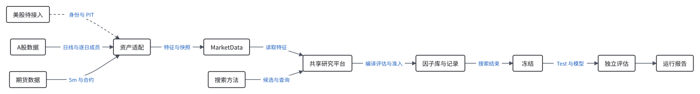

# Alpha Atlas

**面向 Alpha 发现的量化知识地图：导航、探索与拓展知识前沿**

Alpha Atlas 是因子搜索与研究评估平台。它把市场假说转化为可检验的因子表达式，记录搜索、
评估和因子之间的关系，帮助研究者判断已经探索了什么，以及下一步值得研究什么。
项目希望结合研究语义、表达式结构和实证行为，识别相似信号并组织研究证据。

目前平台提供统一数据接口、表达式 DSL、因子评估与准入、研究地图、运行恢复和冻结后的
样本外评估。它支持随机搜索、遗传规划、符号搜索及多种 LLM 方法。完整的开放式知识地图
仍是研究方向，方法接入也不代表已经复现原论文收益。

## 架构

[](docs/figures/architecture.svg)

- **资产接入**：[assets/](src/alpha_atlas/assets/) 负责数据来源、证券身份、时间、成员和质量映射，
  通过 `MarketData` 提供特征；评价层根据资产配置构造目标。不同资产的频率、标签和指标可不同；
  新资产还须验证对应适配和评价口径。
- **方法接入**：[methods/](src/alpha_atlas/methods/) 负责候选生成、搜索策略和奖励，复用
  `SearchSession` 的研究工具；平台统一负责执行、评价、预算和准入。AlphaAtlas 方法由
  Explorer 选方向、Analyst 制定计划、Miner 生成候选，其他方法沿用各自策略。
  方法与实现边界见[方法目录](docs/methods/README.md)。
- **实验执行**：[runner.py](src/alpha_atlas/runner.py) 负责单次运行、恢复和冻结；
  [incremental.py](src/alpha_atlas/incremental.py) 负责预先声明的多方法配对比较。
  每个资产、数据集、股票池、fold、方法、seed 和运行 ID 独立维护因子库与地图。

搜索只使用 Train / Val 反馈；研究决策冻结后才读取 Test。方法奖励不代替平台准入，
共享框架也不意味着不同资产或不同搜索空间的结果可以直接比较。

## 安装与数据

需要 Python 3.13 和 uv。在仓库根目录运行：

```bash
uv sync
uv run atlas --help
uv run atlas data-status
```

数据保存在 `data/`，不随 Git 分发。当前支持 RiceQuant 原生 A 股日线和期货 5 分钟数据：
A 股使用历史逐日股票池；期货使用真实合约，标签不跨合约或连续段，因子窗口按资产 profile 设置。
美股演示材料为合成数据，正式资产适配和 PIT 尚未验证。数据口径与限制见[研究协议](docs/research_protocol.md)。

如需自行采集数据，先安装 `uv sync --extra ricequant`，再显式执行对应命令，凭据文件放在仓库外：

```bash
uv run python scripts/acquire_data.py futures --env-file <凭据文件>
uv run python scripts/acquire_data.py ashare --env-file <凭据文件>
uv run atlas audit-data --asset futures
```

A 股审计将资产名换成 `ashare`。采集与审计结果见数据目录的 `manifest.json` 和 `audit.json`；
正式运行默认要求数据完整。历史版本固定数据快照，必须准备版本指定的原快照，普通采集不会
自动重建历史 Kernel 快照。LLM 方法还需要对应的模型服务配置。

## 统一实验入口

所有搜索方法通过同一个 `atlas run` 入口运行。下面的示例使用本地已审计的原生期货数据，
以无需模型服务的 Random 方法搜索 10 次并冻结，不打开 Test：

```bash
uv run atlas run --asset futures --fold fold2 --method random --attempts 10 --search-only
```

使用冻结配置时，先查看配置，再启动同一个入口。下面是历史 fold2 的 V3 异步与残差准入配置：

```bash
uv run atlas versions
uv run atlas versions rq8_fold2_v3async_luna_p8_pe8_px3_avail_nodepth_residual_v10
uv run atlas run --config rq8_fold2_v3async_luna_p8_pe8_px3_avail_nodepth_residual_v10 --attempts 1000 --search-only
```

`--config` 读取 [configs/versions/](configs/versions/) 中的配置名，固定数据快照、资产、fold、
字段、准入和方法参数。配置只包含一个方法时自动选择；包含多个方法时必须用 `--method` 指定。
不同方法须在配置中声明，部分方法还有诊断或残差设置要求，见[方法目录](docs/methods/README.md)。
使用 `--asset` 和 `--fold` 时，从资产配置及根目录 TOML 读取默认值。`--attempts` 可指定本次预算；
不指定时使用配置中的预算。

搜索返回的 `run_dir` 是后续操作的入口。确认全部开发决策已冻结后，再执行完整评估：

```bash
uv run atlas resume <run_dir> --search-only  # 仅在搜索中断时续跑
uv run atlas finish <run_dir>                # 冻结后执行 OOS、模型与报告
uv run atlas ui                              # 本地监控、研究记录与地图回放
```

不加 `--search-only` 时，`run` 和 `resume` 在搜索冻结后默认执行完整评估，会读取 Test。
运行结果保存在 `artifacts/runs/<run_id>/`，从 `report.md` 阅读；关键进度日志保存在
`logs/cli/`。运行不会自动改写[实验总表](experiment_overview.md)，研究者根据报告人工整理结论。

重复单次实验可复用同一配置，每次 `atlas run` 产生独立运行 ID。多方法配对比较使用
`atlas experiment <scope.json>`；同一 scope、方法和 seed 的重复调用用于恢复。历史配置和
运行产物保留原身份；历史批次可能依赖 Git 忽略的数据和源码快照。详细流程见[研究协议](docs/research_protocol.md)。

## 文档

- [研究协议](docs/research_protocol.md)：数据、划分、评价、实验流程与 OOS。
- [方法目录](docs/methods/README.md)和[方法复现规范](docs/method_reproduction.md)：方法机制、配置与公平比较。
- [DSL 与算子](docs/dsl.md)、[研究工具](docs/research_tools.md)、[模型评估](docs/model.md)：公共接口和数值口径。
- [实验记录](docs/records/experiments.md)和[数据记录](docs/records/data.md)：历史证据及限制。
- [知识地图设计](docs/design.md)和[开发指南](docs/development.md)：研究设想、模块职责与开发检查。
