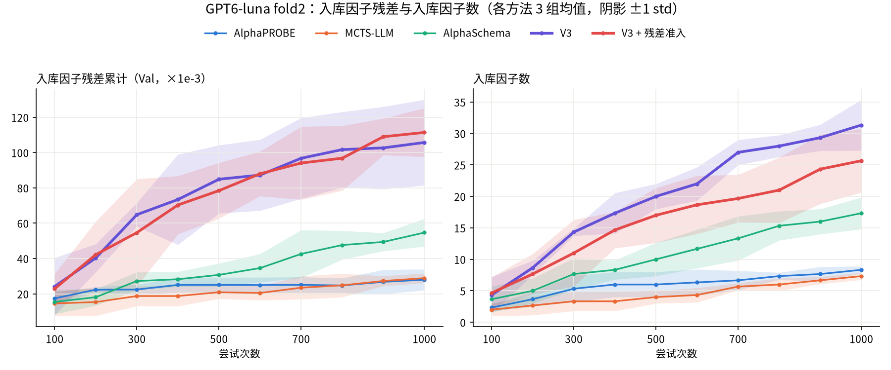

# 实验记录

## 实验总览

已完成期货 AlphaPROBE、MCTS-LLM、ReAct 与 AlphaAtlas+Annealing V1 Async 的
fold1 OOS 评估。
仓库目前没有美股数据适配或美股实验记录。

结果表按研究模型分组：DeepSeek、Haiku 5.5、GPT6-luna；Fold1 另列 GPT5.5。
同一模型内先列 AlphaPROBE、MCTS-LLM、ReAct、AlphaSchema，AlphaAtlas 放在组末；各独立运行的 500／1000 次结果相邻。
AlphaAtlas 方法名统一为 AlphaAtlas V1、AlphaAtlas V2、AlphaAtlas V3，配置细节见报告链接。
主表与相似度表仅保留 500／1000 次节点，其他中途或提前结束结果保留在原报告及实验记录中。

单因子列均使用 TEST 指标：Pearson 与 Spearman 均展示跨因子的均值 / 中位数，位于“正 IC”列之前。
其中“加权”指每个因子的 IC 按品种 √成交额加权聚合。

### 主要实验与结果入口

| 实验 | 内容与范围 |
| --- | --- |
| [期货 fold1 搜索](#期货因子搜索) | AlphaPROBE、MCTS-LLM、ReAct 与 AlphaAtlas 的单因子和组合评估；数据快照不同的结果不能直接归因于方法。 |
| [期货 fold2 搜索](#期货因子搜索fold2) | Kernel 八字段上的多模型、多方法对照；另列 [Val 库内相似度](#期货库内因子相似度fold2--product-窗口)。 |
| [B26 初始库增量](#b26-初始库增量补充2026-11-03) | 比较加入各方法新因子后的配对模型增益；固定品种及模型参数的重测是看过 Test 后的诊断。 |
| [Luna 规模曲线](#规模曲线fold2-gpt6-luna2026-11-09) | 每方法三次运行，比较入库规模、Val 残差及组合结果；同 seed，属于探索性对照。 |
| [等数量 PCA 维度率](#等数量因子库的-pca-有效维度率) | 每库抽取 7 个因子，比较 Val 上的线性冗余；不衡量预测能力。 |

运行报告链接和完整数值保留在下方各表；历史过程见[实验记录](docs/records/experiments.md)。

---

## 数据

### 期货（原生 5m，既有实验）

- **来源 / 频率**：RiceQuant 原生 5 分钟数据；使用主力真实合约，按品种汇总。
- **请求区间**：2015-01-01 至 2026-09-01（含端点）；记录的实际交易日覆盖为
  2015-01-05 至 2026-09-01。
- **实验快照**：`e2e9e697fef4013c86e4be21a7841abc30ba8041c2b6d1087bcaa7f8d838a2e8`。

### 期货 Research Kernel 四字段

- **来源 / 频率**：ChaoticTrader_Future research kernel 的 RiceQuant final 主力真实合约
  1m 数据，按此前指定口径合并为 5m；使用 kernel 已有的换月累计比例复权价格。
- **字段 / 目标**：`adj_close`、`adj_vwap`、`volume`、`amount`；目标为未来 12 根基础
  5m 的 `adj_close` 对数收益，因子观测频率可用 5m、15m、30m、60m、1d。
- **实际覆盖**：2012-01-04 至 2026-09-28，13,559,126 行、97 个品种；fold1 预热从
  2015-01-01 开始，搜索与测试只读取各自允许的日期范围。
- **运行记录的 MarketData 快照**：
  `8f689ef3680e43b4f8f1c21f92bd21ad5f4c6a308e19ad31530f60bda4b4b49a`。
- **比较范围**：AlphaPROBE 的 deepseek-flash 500、1000 次结果、V1 Async 和 ReAct 四字段结果
  使用该复权派生快照；ReAct 八字段使用下方独立快照，其余期货实验使用上方原生 5m 数据；
  不同快照上的实验差异不能单独归因于方法或语言模型。
  聚合、缺失与来源详见
  [数据记录](docs/records/data.md#2026-10-19-research-kernel-复权五分钟导出)。

### 期货 Research Kernel 完整字段

- **资产 / 目录**：`futures_kernel_5m_full` / `data/futures_kernel_5m_full/`。
- **字段 / 目标**：`adj_open`、`adj_high`、`adj_low`、`adj_close`、`adj_vwap`、`volume`、
  `amount`、`open_interest`；目标仍为未来 12 根基础 5m 的 `adj_close` 对数收益。
- **实际覆盖**：2012-01-04 至 2026-09-28，13,559,126 行、97 个品种，177 个月度分区。
- **MarketData 快照**：
  `73db06c2d7223ce5829b8d3d9846a27b35e59e0d621a11a4a94d99dcc6ec0e87`。
- **使用范围**：ReAct 八字段的 500 次结果使用此快照；AlphaPROBE、V1 Async 和 ReAct 四字段
  的 Kernel 结果使用上方四字段快照。
  聚合、缺失与审计见[完整字段记录](docs/records/data.md#2026-10-23-research-kernel-完整字段导出)。

### A 股

- **来源 / 频率**：RiceQuant 原生日线及 PIT 基本面；union1800 是 HS300、ZZ500、ZZ1000
  历史成员的逐日并集。
- **请求区间**：2015-01-01 至 2026-09-01（含端点）；记录的实际交易日覆盖为
  2015-01-05 至 2026-09-01。
- **实验快照**：`abfc6d04d953633b82f844406443a774fb45ced8a6d301a2837084a6849c6710`。
- **基本面时点**：财务数据延后一交易日使用；历史修订限制见[数据快照说明](docs/records/data.md)。

### 美股

尚未确定数据来源、频率和日期范围；仓库没有对应的数据配置或快照。

---

## 已完成实验

### 期货因子搜索

**Fold / seed**：fold1 / 42。

- **目标**：预测未来 12 根 5 分钟 Bar 的对数收益。
- **搜索设置**：开放 `futures_cta` 参考库，首轮不预置因子，seed 42；各组尝试次数见表。
- **Fold1**：train 2016-01-01–2018-12-31，val 2019-01-01–2020-12-31，test
  2021-01-01–2022-12-31。
- **结果汇总日期**：gpt-5.5 版 AlphaPROBE / MCTS-LLM 为 2026-09-18；MCTS + DeepSeek
  500 次为 2026-10-10、1000 次为 2026-10-15；AlphaPROBE + DeepSeek 1000 次为 2026-10-16；
  Kernel V1 Async + DeepSeek 500 次为 2026-10-21，1000 次为 2026-10-22；
  Kernel AlphaPROBE + DeepSeek 500 次为 2026-10-22，1000 次为 2026-10-23；
  Kernel 四字段与八字段 ReAct + DeepSeek 500 次均为 2026-10-23，四字段 1000 次为 2026-10-24。

各实验设置：

- **AlphaPROBE**：gpt-5.5 为 500 次，deepseek-flash 为 500、1000 次；
  embedding 模型均为 Qwen3-Embedding-0.6B。
- **MCTS-LLM**：gpt-5.5 为 500 次，deepseek-flash 为 500、1000 次。
- **ReAct**：AgentScope 单 Agent，deepseek-flash；四字段和八字段分别预设 1000 次预算，
  在 500 次暂停并评估当时完整的已准入因子库。四字段 1000 次保留前 500 次的 65 个成员，
  在第 500 次清空模型上下文后继续搜索；搜索与测试沿用未裁剪口径。
- **AlphaAtlas+Annealing V1 Async**：deepseek-flash；最多并行 3 个研究计划，
  每计划最多 5 个候选；Explorer 对话上限 40 轮，三个 Agent 均可调用共同的五项只读研究工具。

| 实验人 | 方法 | 数据 | 模型 | 尝试次数 | TEST 单因子加权 Pearson（均值 / 中位数） | TEST 单因子加权 Spearman（均值 / 中位数） | 正 IC | Linear 加权 Pearson | LightGBM 加权 Pearson |
| --- | --- | --- | --- | ---: | ---: | ---: | ---: | ---: | ---: |
| 汤子逸 | AlphaPROBE | 原生 5m | deepseek-flash | 1000 | 0.002365 / 0.002410 | 0.000062 / -0.000429 | 51 / 66（77.3%） | 0.012144 | 0.020982 |
| 汤子逸 | AlphaPROBE | Kernel 四字段 | deepseek-flash | 500 | 0.002922 / 0.003593 | 0.002988 / 0.001773 | 38 / 48（79.17%） | 0.011288 | 0.016138 |
| 汤子逸 | AlphaPROBE | Kernel 四字段 | deepseek-flash | 1000 | 0.002679 / 0.003072 | 0.002439 / 0.001733 | 60 / 78（76.92%） | 0.014138 | 0.015396 |
| 汤子逸 | MCTS-LLM | 原生 5m | deepseek-flash | 500 | 0.002512 / 0.001987 | 0.000301 / 0.000037 | 26 / 35（74.3%） | 0.007910 | 0.008754 |
| 汤子逸 | MCTS-LLM | 原生 5m | deepseek-flash | 1000 | 0.001567 / 0.001223 | 0.000212 / -0.000997 | 38 / 60（63.3%） | 0.004354 | 0.009233 |
| 汤子逸 | [ReAct](artifacts/runs/futures_kernel_5m-all-fold1-react-42-145195d3de-prefix500/report.md) | Kernel 四字段 | deepseek-flash | 500 | 0.002494 / 0.001603 | 0.001632 / 0.000231 | 44 / 65，67.69% | 0.012126 | 0.019378 |
| 汤子逸 | [ReAct](artifacts/runs/futures_kernel_5m-all-fold1-react-42-6990ca0c5f/report.md) | Kernel 四字段 | deepseek-flash | 1000 | 0.001763 / 0.001166 | 0.000621 / 0.000073 | 88 / 136，64.71% | 0.012771 | 0.021948 |
| 汤子逸 | [ReAct](artifacts/runs/futures_kernel_5m_full-all-fold1-react-42-af44aa3bd0-prefix500/report.md) | Kernel 八字段 | deepseek-flash | 500 | 0.004672 / 0.005051 | 0.001008 / 0.000820 | 53 / 68（77.94%） | 0.008176 | 0.015305 |
| 汤子逸 | AlphaAtlas V1 | Kernel 四字段 | deepseek-flash | 500 | 0.003563 / 0.003538 | 0.002211 / 0.002478 | 52 / 64（81.25%） | 0.013123 | 0.015892 |
| 汤子逸 | AlphaAtlas V1 | Kernel 四字段 | deepseek-flash | 1000 | 0.004134 / 0.004646 | 0.004777 / 0.005219 | 147 / 166（88.55%） | 0.016481 | 0.019924 |
| 汤子逸 | AlphaPROBE | 原生 5m | gpt-5.5 | 500 | 0.002393 / 0.001559 | 0.003421 / 0.004764 | 27 / 37（73.0%） | 0.006413 | 0.011228 |
| 汤子逸 | MCTS-LLM | 原生 5m | gpt-5.5 | 500 | 0.002785 / 0.003165 | 0.002229 / 0.002286 | 32 / 44（72.7%） | 0.008493 | 0.017879 |

单因子沿用训练方向。已评估的下游模型使用冻结因子库在 train+val 拟合，LightGBM 固定 50 轮。
ReAct 四字段 500 次行对应运行 `futures_kernel_5m-all-fold1-react-42-145195d3de` 的
[500 次评估快照](artifacts/runs/futures_kernel_5m-all-fold1-react-42-145195d3de-prefix500/report.md)。
1000 次行对应 `futures_kernel_5m-all-fold1-react-42-6990ca0c5f`，
见[单因子报告](artifacts/runs/futures_kernel_5m-all-fold1-react-42-6990ca0c5f/report.md)和
[模型报告](artifacts/runs/futures_kernel_5m-all-fold1-react-42-6990ca0c5f/model/report.md)。
与首轮四字段 `ac32f1e3dc` 的结果见[复跑对照](artifacts/comparisons/react_kernel_four_repeat_145195d3de/results_comparison.html)。

### 期货库内因子相似度：统一 product 窗口

**Fold / seed**：fold1 / 42。

截至 2026-11-02，下表 12 组结果的相似度均按 **product 窗口**，
在 **Val 2019–2020** 上评估。
每对因子取共同有限观测重新排名，计算绝对 Spearman；全部不同因子对等权平均，排除自身相关，
不重复计数、不抽样、不填补缺失。此处沿用库内去重的 pooled 行口径，不使用品种成交额权重。
Kernel 四字段的 AlphaPROBE、V1 Async 与 ReAct 使用四字段 Research Kernel 复权派生快照，
ReAct 八字段使用八字段 Kernel 快照；
原生 5m 各组使用对应快照；
不同快照间的数值差异不能作为同数据条件下的方法排名。

| 方法 / 模型 | 数据 | 尝试次数 | 因子数 | 因子对数 | 平均绝对 Spearman | 中位数 | P90 | 最大值 | ≥ 0.7 的对数 |
| --- | --- | ---: | ---: | ---: | ---: | ---: | ---: | ---: | ---: |
| AlphaPROBE / deepseek-flash | 原生 5m | 1000 | 66 | 2145 | 0.109710 | 0.053192 | 0.294732 | 0.695848 | 0 |
| AlphaPROBE / deepseek-flash | Kernel 四字段 | 500 | 48 | 1128 | 0.155238 | 0.096048 | 0.418874 | 0.699248 | 0 |
| AlphaPROBE / deepseek-flash | Kernel 四字段 | 1000 | 78 | 3003 | 0.149145 | 0.091602 | 0.397867 | 0.699248 | 0 |
| MCTS-LLM / deepseek-flash | 原生 5m | 500 | 35 | 595 | 0.184539 | 0.131507 | 0.431388 | 0.699873 | 0 |
| MCTS-LLM / deepseek-flash | 原生 5m | 1000 | 60 | 1770 | 0.131032 | 0.069709 | 0.355669 | 0.699873 | 0 |
| [ReAct](artifacts/runs/futures_kernel_5m-all-fold1-react-42-145195d3de-prefix500/report.md) / deepseek-flash | Kernel 四字段 | 500 | 65 | 2080 | 0.208221 | 0.170754 | 0.463688 | 0.695703 | 0 |
| [ReAct](artifacts/runs/futures_kernel_5m-all-fold1-react-42-6990ca0c5f/report.md) / deepseek-flash | Kernel 四字段 | 1000 | 136 | 9180 | 0.179021 | 0.140757 | 0.411079 | 0.695703 | 0 |
| [ReAct](artifacts/runs/futures_kernel_5m_full-all-fold1-react-42-af44aa3bd0-prefix500/report.md) / deepseek-flash | Kernel 八字段 | 500 | 68 | 2278 | 0.119819 | 0.042138 | 0.355628 | 0.699055 | 0 |
| AlphaAtlas V1 / deepseek-flash | Kernel 四字段 | 500 | 64 | 2016 | 0.115394 | 0.072774 | 0.288826 | 0.695866 | 0 |
| AlphaAtlas V1 / deepseek-flash | Kernel 四字段 | 1000 | 166 | 13695 | 0.127824 | 0.073150 | 0.332904 | 0.695866 | 0 |
| AlphaPROBE / gpt-5.5 | 原生 5m | 500 | 37 | 666 | 0.193626 | 0.149755 | 0.425736 | 0.688010 | 0 |
| MCTS-LLM / gpt-5.5 | 原生 5m | 500 | 44 | 946 | 0.145717 | 0.091692 | 0.352664 | 0.700253 | 1 |

ReAct 四字段的逐对结果与准入核对见[相似度汇总](artifacts/comparisons/react_kernel_four_reset500_6990ca0c5f/similarity_summary.json)。

### 美股

仓库尚无美股资产配置、数据适配或 TEST 实验。开展前需先确定数据来源与使用范围、股票池、频率和
独立的 fold 设计。

### 期货因子搜索：fold2

AlphaAtlas 的 DeepSeek 与 GPT6-luna 的 1000 次完整结果分别入库 143 与 36 个因子；
MCTS-LLM + GPT6-luna 的 1000 次完整结果入库 7 个因子；
AlphaPROBE + DeepSeek 的 1000 次完整结果入库 31 个因子。结果与相似度见下方两表。

**数据设置**：Kernel 八字段 / all / 裁剪 1%–99%。

**Fold / seed**：fold2 / 42。

Train：2019-01-01–2021-12-31；Val：2022-01-01–2023-12-31；Test：2024-01-01–2025-12-31。

500 次为同一 1000 次预算运行的前 500 次提交截面；组合模型分别使用各截面的因子库拟合。

DeepSeek＋MCTS-LLM（79ad3e5e40）已完成1000次；500／1000次截面分别入库26／45个因子，组合模型均按本表统一参数评估。

本表 Linear／LightGBM 均采用 Train+Val 全局特征及标签 1%–99% 裁剪、品种全拟合期去均值；Test 复用特征边界，标签保持原值。LightGBM 统一为 `num_boost_round=50, min_data_in_leaf=2000, max_depth=5`。

AlphaSchema 的搜索诊断与历史对照存在差异，适配边界和统一评估配置见
[复现记录](docs/records/experiments.md#2026-11-02-alphaschema真实试跑与-fold2-luna-比较配置)。

既有 AlphaAtlas Haiku 5.5 运行（ef96a68059）使用英文提示词和公共 JSON 兼容逻辑，第 444 次后启用证据驱动回访，
第 887 次后修正补位不足的调度与近期研究证据交接。
提示词、搜索策略及 CLI 采样后端与 DeepSeek 存在差异，比较范围见[实验记录](docs/records/experiments.md)。
本轮 Haiku 运行 531d4676f6 的 500／1000 次结果独立列出，分别入库 25／67 个因子；原轮结果保留。

V2 Sync 尺度统计版（630b551ad5）使用 `rq8_fold2_v2sync_haiku_v2`，开启库残差与
`scale_statistics` 反馈，搜索协议与既有 V1 不同；500 次截面的组合模型覆盖率为 99.9948%。
配置、结果与边界见[实验记录](docs/records/experiments.md#2026-11-04-v2-sync-haiku尺度统计版前500次截面评估)。

Haiku V3 串行组与无深挖续跑组共享同一前 500 次截面；其单因子统计按冻结成员从[串行组最终 OOS 结果](artifacts/comparisons/v3async2_haiku_fold2_20261105/workspace/artifacts/runs/futures_kernel_5m_full-all-fold2-v3_async-42-20a1012038/oos.json)提取。

| 实验人 | 方法 | 模型 | 尝试次数 | TEST 单因子加权 Pearson（均值 / 中位数） | TEST 单因子加权 Spearman（均值 / 中位数） | 正 IC | Linear 加权 Pearson | LightGBM 加权 Pearson | Linear 加权 Spearman | LightGBM 加权 Spearman |
| --- | --- | --- | --- | --- | --- | --- | --- | --- | --- | --- |
| — | [AlphaPROBE](artifacts/comparisons/fold2_missing_prefix500_20261031/deepseek_probe/workspace/artifacts/runs/futures_kernel_5m_full-all-fold2-alphaprobe-42-9cbc979fab-prefix500/report.md) | deepseek-flash | 500 | 0.004916 / 0.004184 | 0.001449 / 0.001633 | 21 / 22，95.45% | [0.012582](artifacts/comparisons/fold2_missing_prefix500_20261031/deepseek_probe/workspace/artifacts/runs/futures_kernel_5m_full-all-fold2-alphaprobe-42-9cbc979fab-prefix500/model/report.md) | [0.015618](artifacts/comparisons/fold2_missing_prefix500_20261031/deepseek_probe/workspace/artifacts/runs/futures_kernel_5m_full-all-fold2-alphaprobe-42-9cbc979fab-prefix500/model/report.md) | — | — |
| — | [AlphaPROBE](artifacts/comparisons/alphaprobe_deepseek_fold2_20261030/workspace/artifacts/runs/futures_kernel_5m_full-all-fold2-alphaprobe-42-9cbc979fab/report.md) | deepseek-flash | 1000 | 0.004924 / 0.004262 | 0.002026 / 0.001720 | 30 / 31，96.77% | [0.013744](artifacts/comparisons/alphaprobe_deepseek_fold2_20261030/workspace/artifacts/runs/futures_kernel_5m_full-all-fold2-alphaprobe-42-9cbc979fab/model/report.md) | [0.014567](artifacts/comparisons/alphaprobe_deepseek_fold2_20261030/workspace/artifacts/runs/futures_kernel_5m_full-all-fold2-alphaprobe-42-9cbc979fab/model/report.md) | — | — |
| — | [MCTS-LLM](artifacts/comparisons/fold2_missing_prefix500_20261031/deepseek_mcts/workspace/artifacts/runs/futures_kernel_5m_full-all-fold2-mcts_llm-42-79ad3e5e40-prefix500/report.md) | deepseek-flash | 500 | 0.002410 / 0.002238 | 0.000351 / -0.001312 | 19 / 26，73.08% | [0.007819](artifacts/comparisons/fold2_missing_prefix500_20261031/deepseek_mcts/workspace/artifacts/runs/futures_kernel_5m_full-all-fold2-mcts_llm-42-79ad3e5e40-prefix500/model/report.md) | [0.010176](artifacts/comparisons/fold2_missing_prefix500_20261031/deepseek_mcts/workspace/artifacts/runs/futures_kernel_5m_full-all-fold2-mcts_llm-42-79ad3e5e40-prefix500/model/report.md) | — | — |
| — | [MCTS-LLM](artifacts/runs/futures_kernel_5m_full-all-fold2-mcts_llm-42-79ad3e5e40/report.md) | deepseek-flash | 1000 | 0.003213 / 0.003253 | 0.000289 / -0.000323 | 36 / 45，80.00% | [0.009376](artifacts/comparisons/mcts_llm_deepseek_79ad3e5e40_full1000_20261101/workspace/artifacts/runs/futures_kernel_5m_full-all-fold2-mcts_llm-42-79ad3e5e40-uniform50-leaf2000-depth5/model/report.md) | [0.015224](artifacts/comparisons/mcts_llm_deepseek_79ad3e5e40_full1000_20261101/workspace/artifacts/runs/futures_kernel_5m_full-all-fold2-mcts_llm-42-79ad3e5e40-uniform50-leaf2000-depth5/model/report.md) | — | — |
| — | [AlphaSchema](artifacts/comparisons/alphaschema_deepseek_fold2_20261103/workspace/artifacts/runs/futures_kernel_5m_full-all-fold2-alphaschema-42-69020461a6-prefix500/report.md) | deepseek-flash | 500 | 0.006462 / 0.006366 | 0.003874 / 0.003346 | 23 / 23，100.00% | 0.012882 | 0.014689 | — | — |
| — | [AlphaSchema](artifacts/comparisons/alphaschema_deepseek_fold2_20261103/workspace/artifacts/runs/futures_kernel_5m_full-all-fold2-alphaschema-42-69020461a6/report.md) | deepseek-flash | 1000 | 0.006122 / 0.006035 | 0.002672 / 0.001644 | 34 / 34，100.00% | 0.013154 | 0.015982 | — | — |
| — | [AlphaAtlas V1](artifacts/runs/futures_kernel_5m_full-all-fold2-v1_async-42-4e3f0e7900-prefix500/report.md) | deepseek-flash | 500 | 0.003478 / 0.002727 | 0.002806 / 0.001160 | 18 / 23，78.26% | [0.013321](artifacts/comparisons/fold2_uniform_lgbm50_leaf2000_depth5_20261030/deepseek_old/artifacts/runs/futures_kernel_5m_full-all-fold2-v1_async-42-4e3f0e7900-prefix500-uniform50-leaf2000-depth5/model/report.md) | [0.011558](artifacts/comparisons/fold2_uniform_lgbm50_leaf2000_depth5_20261030/deepseek_old/artifacts/runs/futures_kernel_5m_full-all-fold2-v1_async-42-4e3f0e7900-prefix500-uniform50-leaf2000-depth5/model/report.md) | — | — |
| — | [AlphaAtlas V1](artifacts/runs/futures_kernel_5m_full-all-fold2-v1_async-42-4e3f0e7900/report.md) | deepseek-flash | 1000 | 0.002062 / 0.001921 | 0.001211 / 0.000288 | 38 / 52，73.08% | [0.015020](artifacts/comparisons/fold2_uniform_lgbm50_leaf2000_depth5_20261030/deepseek_old/artifacts/runs/futures_kernel_5m_full-all-fold2-v1_async-42-4e3f0e7900-uniform50-leaf2000-depth5/model/report.md) | [0.021267](artifacts/comparisons/fold2_uniform_lgbm50_leaf2000_depth5_20261030/deepseek_old/artifacts/runs/futures_kernel_5m_full-all-fold2-v1_async-42-4e3f0e7900-uniform50-leaf2000-depth5/model/report.md) | — | — |
| — | [AlphaAtlas V1](artifacts/runs/futures_kernel_5m_full-all-fold2-v1_async-42-958979b287-prefix500/report.md) | deepseek-flash | 500 | 0.003331 / 0.003309 | 0.000270 / 0.000886 | 58 / 70，82.86% | [0.012860](artifacts/comparisons/lgbm_leaf2000_depth5_fold2_20261030/deepseek70/artifacts/runs/futures_kernel_5m_full-all-fold2-v1_async-42-958979b287-prefix500-leaf2000-depth5/model/report.md) | [0.011751](artifacts/comparisons/lgbm_leaf2000_depth5_fold2_20261030/deepseek70/artifacts/runs/futures_kernel_5m_full-all-fold2-v1_async-42-958979b287-prefix500-leaf2000-depth5/model/report.md) | — | — |
| — | [AlphaAtlas V1](artifacts/runs/futures_kernel_5m_full-all-fold2-v1_async-42-958979b287/report.md) | deepseek-flash | 1000 | 0.003193 / 0.003029 | 0.000698 / 0.000800 | 105 / 143，73.43% | [0.024103](artifacts/comparisons/lgbm_leaf2000_depth5_fold2_20261030/deepseek143/artifacts/runs/futures_kernel_5m_full-all-fold2-v1_async-42-958979b287-leaf2000-depth5/model/report.md) | [0.018880](artifacts/comparisons/lgbm_leaf2000_depth5_fold2_20261030/deepseek143/artifacts/runs/futures_kernel_5m_full-all-fold2-v1_async-42-958979b287-leaf2000-depth5/model/report.md) | — | — |
| — | [AlphaAtlas V3](artifacts/comparisons/v3async_deepseek_low_fold2_20261105/workspace/artifacts/runs/futures_kernel_5m_full-all-fold2-v3_async-42-debb1b1dfd/report.md) | deepseek-flash | 1000 | 0.004421 / 0.004357 | 0.004879 / 0.004304 | 73 / 83，87.95% | 0.019145 | 0.005648 | — | — |
| — | [AlphaAtlas V3](artifacts/comparisons/v3async_deepseek_fold2_20261104/workspace/artifacts/runs/futures_kernel_5m_full-all-fold2-v3_async-42-4e2a92c781/report.md) | deepseek-flash | 1000 | 0.003619 / 0.003513 | 0.003187 / 0.003305 | 79 / 95，83.16% | 0.015633 | 0.009349 | — | — |
| — | [AlphaAtlas V3](artifacts/comparisons/v3async2_deepseek_low_fold2_20261105/workspace/artifacts/runs/futures_kernel_5m_full-all-fold2-v3_async-42-bfabcc7663-prefix500/report.md) | deepseek-flash（low） | 500 | — | — | — | [0.011093](artifacts/comparisons/v3async2_deepseek_low_fold2_20261105/workspace/artifacts/runs/futures_kernel_5m_full-all-fold2-v3_async-42-bfabcc7663-prefix500/model/report.md) | [0.015482](artifacts/comparisons/v3async2_deepseek_low_fold2_20261105/workspace/artifacts/runs/futures_kernel_5m_full-all-fold2-v3_async-42-bfabcc7663-prefix500/model/report.md) | — | — |
| — | [AlphaAtlas V3](artifacts/comparisons/v3async4_deepseek_low_p10_fold2_20261105/workspace/artifacts/runs/futures_kernel_5m_full-all-fold2-v3_async-42-3f8261a9ad-prefix500/report.md) | deepseek-flash（low） | 500 | — | — | — | [0.017090](artifacts/comparisons/v3async4_deepseek_low_p10_fold2_20261105/workspace/artifacts/runs/futures_kernel_5m_full-all-fold2-v3_async-42-3f8261a9ad-prefix500/model/report.md) | [0.012079](artifacts/comparisons/v3async4_deepseek_low_p10_fold2_20261105/workspace/artifacts/runs/futures_kernel_5m_full-all-fold2-v3_async-42-3f8261a9ad-prefix500/model/report.md) | — | — |
| — | [AlphaAtlas V3](artifacts/comparisons/v3async6_deepseek_low_avail_nodepth_fold2_20261105/workspace/artifacts/runs/futures_kernel_5m_full-all-fold2-v3_async-42-e78d475f38-prefix500/report.md) | deepseek-flash（low） | 500 | — | — | — | [0.011632](artifacts/comparisons/v3async6_deepseek_low_avail_nodepth_fold2_20261105/workspace/artifacts/runs/futures_kernel_5m_full-all-fold2-v3_async-42-e78d475f38-prefix500/model/report.md) | [0.016788](artifacts/comparisons/v3async6_deepseek_low_avail_nodepth_fold2_20261105/workspace/artifacts/runs/futures_kernel_5m_full-all-fold2-v3_async-42-e78d475f38-prefix500/model/report.md) | — | — |
| — | [AlphaAtlas V3](artifacts/comparisons/v3async6_deepseek_low_avail_nodepth_fold2_20261105/workspace/artifacts/runs/futures_kernel_5m_full-all-fold2-v3_async-42-e78d475f38/report.md) | deepseek-flash | 1000 | 0.006286 / 0.005327 | 0.002708 / 0.002373 | 41 / 43，95.35% | 0.016252 | 0.025573 | — | — |
| — | [AlphaPROBE](artifacts/runs/futures_kernel_5m_full-all-fold2-alphaprobe-42-bc919289de-prefix500/report.md) | claude-haiku-5-5 | 500 | 0.006127 / 0.005777 | 0.003995 / 0.006695 | 20 / 20，100.00% | [0.014790](artifacts/comparisons/fold2_uniform_lgbm50_leaf2000_depth5_20261030/haiku_alphaprobe/artifacts/runs/futures_kernel_5m_full-all-fold2-alphaprobe-42-bc919289de-prefix500-uniform50-leaf2000-depth5/model/report.md) | [0.021805](artifacts/comparisons/fold2_uniform_lgbm50_leaf2000_depth5_20261030/haiku_alphaprobe/artifacts/runs/futures_kernel_5m_full-all-fold2-alphaprobe-42-bc919289de-prefix500-uniform50-leaf2000-depth5/model/report.md) | — | — |
| — | [AlphaPROBE](artifacts/runs/futures_kernel_5m_full-all-fold2-alphaprobe-42-bc919289de/report.md) | claude-haiku-5-5 | 1000 | 0.004680 / 0.004562 | 0.003117 / 0.000524 | 29 / 32，90.62% | [0.014016](artifacts/comparisons/fold2_uniform_lgbm50_leaf2000_depth5_20261030/haiku_alphaprobe/artifacts/runs/futures_kernel_5m_full-all-fold2-alphaprobe-42-bc919289de-uniform50-leaf2000-depth5/model/report.md) | [0.017633](artifacts/comparisons/fold2_uniform_lgbm50_leaf2000_depth5_20261030/haiku_alphaprobe/artifacts/runs/futures_kernel_5m_full-all-fold2-alphaprobe-42-bc919289de-uniform50-leaf2000-depth5/model/report.md) | — | — |
| — | [MCTS-LLM](artifacts/runs/futures_kernel_5m_full-all-fold2-mcts_llm-42-aa870d70c5-prefix500/report.md) | claude-haiku-5-5 | 500 | 0.007796 / 0.008423 | 0.009183 / 0.011305 | 13 / 13，100.00% | [0.013805](artifacts/comparisons/fold2_uniform_lgbm50_leaf2000_depth5_20261030/haiku_mcts/artifacts/runs/futures_kernel_5m_full-all-fold2-mcts_llm-42-aa870d70c5-prefix500-uniform50-leaf2000-depth5/model/report.md) | [0.013144](artifacts/comparisons/fold2_uniform_lgbm50_leaf2000_depth5_20261030/haiku_mcts/artifacts/runs/futures_kernel_5m_full-all-fold2-mcts_llm-42-aa870d70c5-prefix500-uniform50-leaf2000-depth5/model/report.md) | — | — |
| — | [MCTS-LLM](artifacts/runs/futures_kernel_5m_full-all-fold2-mcts_llm-42-aa870d70c5/report.md) | claude-haiku-5-5 | 1000 | 0.007479 / 0.007571 | 0.007956 / 0.010700 | 29 / 29，100.00% | [0.012937](artifacts/comparisons/fold2_uniform_lgbm50_leaf2000_depth5_20261030/haiku_mcts/artifacts/runs/futures_kernel_5m_full-all-fold2-mcts_llm-42-aa870d70c5-uniform50-leaf2000-depth5/model/report.md) | [0.014285](artifacts/comparisons/fold2_uniform_lgbm50_leaf2000_depth5_20261030/haiku_mcts/artifacts/runs/futures_kernel_5m_full-all-fold2-mcts_llm-42-aa870d70c5-uniform50-leaf2000-depth5/model/report.md) | — | — |
| — | [AlphaSchema](artifacts/comparisons/alphaschema_haiku55_fold2_20261102/workspace/artifacts/runs/futures_kernel_5m_full-all-fold2-alphaschema-42-41056bb4f8-prefix500/report.md) | claude-haiku-5-5 | 500 | 0.007062 / 0.007249 | 0.004895 / 0.004400 | 19 / 19，100.00% | 0.015361 | 0.016599 | — | — |
| — | [AlphaSchema](artifacts/comparisons/alphaschema_haiku55_fold2_20261102/workspace/artifacts/runs/futures_kernel_5m_full-all-fold2-alphaschema-42-41056bb4f8/report.md) | claude-haiku-5-5 | 1000 | 0.007372 / 0.007545 | 0.005426 / 0.003802 | 40 / 40，100.00% | 0.016929 | 0.018474 | — | — |
| — | [AlphaAtlas V1](artifacts/runs/futures_kernel_5m_full-all-fold2-v1_async-42-ef96a68059-prefix500/report.md) | claude-haiku-5-5 | 500 | 0.006987 / 0.006948 | 0.004490 / 0.006317 | 16 / 17，94.12% | [0.016313](artifacts/comparisons/fold2_uniform_lgbm50_leaf2000_depth5_20261030/haiku_alphaatlas/artifacts/runs/futures_kernel_5m_full-all-fold2-v1_async-42-ef96a68059-prefix500-uniform50-leaf2000-depth5/model/report.md) | [0.020762](artifacts/comparisons/fold2_uniform_lgbm50_leaf2000_depth5_20261030/haiku_alphaatlas/artifacts/runs/futures_kernel_5m_full-all-fold2-v1_async-42-ef96a68059-prefix500-uniform50-leaf2000-depth5/model/report.md) | — | — |
| — | [AlphaAtlas V1](artifacts/runs/futures_kernel_5m_full-all-fold2-v1_async-42-ef96a68059/report.md) | claude-haiku-5-5 | 1000 | 0.006608 / 0.006227 | 0.002971 / 0.003193 | 26 / 31，83.87% | [0.015128](artifacts/comparisons/fold2_uniform_lgbm50_leaf2000_depth5_20261030/haiku_alphaatlas/artifacts/runs/futures_kernel_5m_full-all-fold2-v1_async-42-ef96a68059-uniform50-leaf2000-depth5/model/report.md) | [0.015047](artifacts/comparisons/fold2_uniform_lgbm50_leaf2000_depth5_20261030/haiku_alphaatlas/artifacts/runs/futures_kernel_5m_full-all-fold2-v1_async-42-ef96a68059-uniform50-leaf2000-depth5/model/report.md) | — | — |
| — | [AlphaAtlas V1](artifacts/runs/futures_kernel_5m_full-all-fold2-v1_async-42-531d4676f6-prefix500/report.md) | claude-haiku-5-5 | 500 | 0.009578 / 0.009528 | 0.007932 / 0.007989 | 25 / 25，100.00% | [0.024550](artifacts/runs/futures_kernel_5m_full-all-fold2-v1_async-42-531d4676f6-prefix500/model/report.md) | [0.019086](artifacts/runs/futures_kernel_5m_full-all-fold2-v1_async-42-531d4676f6-prefix500/model/report.md) | — | — |
| — | [AlphaAtlas V1](artifacts/runs/futures_kernel_5m_full-all-fold2-v1_async-42-531d4676f6/report.md) | claude-haiku-5-5 | 1000 | 0.006839 / 0.008537 | 0.007120 / 0.008878 | 55 / 67，82.09% | [0.023549](artifacts/comparisons/haiku55_531d4676f6_full1000_20261031/workspace/artifacts/runs/futures_kernel_5m_full-all-fold2-v1_async-42-531d4676f6-uniform50-leaf2000-depth5/model/report.md) | [0.012112](artifacts/comparisons/haiku55_531d4676f6_full1000_20261031/workspace/artifacts/runs/futures_kernel_5m_full-all-fold2-v1_async-42-531d4676f6-uniform50-leaf2000-depth5/model/report.md) | — | — |
| — | [AlphaAtlas V2](artifacts/comparisons/v2sync_scales_haiku_fold2_20261103/workspace/artifacts/runs/futures_kernel_5m_full-all-fold2-v2_sync-42-630b551ad5-prefix500/report.md) | claude-haiku-5-5 | 500 | 0.004042 / 0.003891 | 0.001888 / 0.001866 | 31 / 35，88.57% | 0.011080 | 0.013874 | — | — |
| — | [AlphaAtlas V3](artifacts/comparisons/v3async_haiku_fold2_20261104/workspace/artifacts/runs/futures_kernel_5m_full-all-fold2-v3_async-42-600bd5bbd1/report.md) | claude-haiku-5-5 | 1000 | 0.003259 / 0.002384 | 0.000900 / 0.001017 | 34 / 43，79.07% | 0.011279 | 0.016154 | — | — |
| — | [AlphaAtlas V3](artifacts/comparisons/v3async2_haiku_fold2_20261105/workspace/artifacts/runs/futures_kernel_5m_full-all-fold2-v3_async-42-20a1012038-prefix500/report.md) | claude-haiku-5-5 | 500 | 0.006393 / 0.006366 | 0.002584 / 0.002349 | 25 / 26，96.15% | [0.024497](artifacts/comparisons/v3async2_haiku_fold2_20261105/workspace/artifacts/runs/futures_kernel_5m_full-all-fold2-v3_async-42-20a1012038-prefix500/model/report.md) | [0.028821](artifacts/comparisons/v3async2_haiku_fold2_20261105/workspace/artifacts/runs/futures_kernel_5m_full-all-fold2-v3_async-42-20a1012038-prefix500/model/report.md) | — | — |
| — | [AlphaAtlas V3](artifacts/comparisons/v3async6_haiku_nodepth_fork500_fold2_20261105/workspace/artifacts/runs/futures_kernel_5m_full-all-fold2-v3_async-42-20a1012038-nodepth500-cont912/report.md) | claude-haiku-5-5 | 1000 | 0.006503 / 0.006706 | 0.001747 / 0.001357 | 38 / 42，90.48% | 0.025755 | 0.022685 | — | — |
| — | [AlphaAtlas V3](artifacts/comparisons/v3async9_haiku_avail_nodepth_p8_fold2_20261105/workspace/artifacts/runs/futures_kernel_5m_full-all-fold2-v3_async-42-f7fec0f4f2/report.md) | claude-haiku-5-5 | 1000 | 0.005187 / 0.003990 | 0.003438 / 0.002693 | 27 / 34，79.41% | 0.014474 | 0.012566 | — | — |
| — | [AlphaPROBE（3 组）](docs/records/scaling_fold2_luna_20261109/luna_runs.md) | gpt-6-luna | 1000 | 0.006213 ± 0.000077 / 0.006250 ± 0.000136 | 0.003933 ± 0.001075 / 0.007143 ± 0.003794 | 8.3 ± 0.6 / 8.3 ± 0.6，100.00 ± 0.00% | 0.010023 ± 0.001437 | 0.014060 ± 0.002554 | 0.016184 ± 0.000291 | 0.014117 ± 0.000800 |
| — | [MCTS-LLM（3 组）](docs/records/scaling_fold2_luna_20261109/luna_runs.md) | gpt-6-luna | 1000 | 0.007292 ± 0.000525 / 0.007751 ± 0.000755 | 0.007317 ± 0.001891 / 0.010689 ± 0.001131 | 7.3 ± 0.6 / 7.3 ± 0.6，100.00 ± 0.00% | 0.008334 ± 0.002100 | 0.009203 ± 0.002995 | 0.014857 ± 0.002899 | 0.014192 ± 0.001602 |
| — | [AlphaSchema（3 组）](docs/records/scaling_fold2_luna_20261109/luna_runs.md) | gpt-6-luna | 1000 | 0.007029 ± 0.000027 / 0.006999 ± 0.000239 | 0.007342 ± 0.000842 / 0.008194 ± 0.002609 | 17.3 ± 2.5 / 17.3 ± 2.5，100.00 ± 0.00% | 0.011802 ± 0.002361 | 0.014504 ± 0.001509 | 0.014216 ± 0.001688 | 0.015530 ± 0.002298 |
| — | [AlphaAtlas V3（3 组）](docs/records/scaling_fold2_luna_20261109/luna_runs.md) | gpt-6-luna | 1000 | 0.005196 ± 0.001134 / 0.005714 ± 0.001092 | 0.004418 ± 0.001426 / 0.004517 ± 0.001499 | 26.3 ± 2.9 / 31.3 ± 4.0，84.23 ± 3.84% | 0.012593 ± 0.002278 | 0.013005 ± 0.002843 | 0.017691 ± 0.002968 | 0.017475 ± 0.001890 |
| — | [AlphaAtlas V3 + 残差准入（3 组）](docs/records/scaling_fold2_luna_20261109/luna_runs.md) | gpt-6-luna | 1000 | 0.005440 ± 0.000922 / 0.006283 ± 0.000928 | 0.004651 ± 0.000233 / 0.003549 ± 0.001441 | 22.0 ± 3.6 / 25.7 ± 5.0，86.12 ± 5.69% | 0.013047 ± 0.006173 | 0.017348 ± 0.004214 | 0.015584 ± 0.002963 | 0.016633 ± 0.001905 |

GPT6-luna 各方法合并为一行（2026-11-10）：数值为该方法 1000 次运行的均值 ± 样本标准差，方法名后注明运行数；AlphaAtlas V1、V2 暂不列入本表（单次运行见明细）。Linear／LightGBM 加权 Spearman 为组合预测的 Test 品种 √成交额加权 Spearman IC，按本表统一参数计算；其他模型的行尚未补算，以“—”表示。单因子列为各运行均值／中位数的均值 ± 标准差，正 IC 为各运行计数与占比的均值 ± 标准差。AlphaAtlas V3 为 v8、v9、v9 r2 （`22d7cdbc4f`、`af75f77310`、`ea03683b78`），V3 + 残差准入为 v10 三组；V3 早期配置 `8d95766cb7`、`bf0c21a38d` 及全部 500 次截面与单次运行行一并移至[单次运行明细](docs/records/scaling_fold2_luna_20261109/luna_runs.md)。AlphaPROBE、MCTS-LLM 2026-11-09 补跑的四组（`2e915baa0a`、`efb9a27cd6`、`95df5036b7`、`bfc98b0bf4`）自身模型配置为`min_data_in_leaf=100`、无深度限制，其 LightGBM 采用本表统一参数重拟合值（`artifacts/comparisons/scaling_curves_fold2_20261109/curves/`）。

新增运行不自动填表；上述三组的汇总行需人工维护。

V3 Async 串行 Haiku（20a1012038）已完成 1000 次，入库 30 个因子；与已测的 902 次
截面相比，完整冻结库和全部模型 Test 指标均相同，主表按最终 1000 次结果列示。
两模型覆盖率均为 99.999844%。
[核对记录](docs/records/experiments.md#2026-11-05-v3-async-串行-haiku最终结果主表核对)。

V3 Async avail nodepth + DeepSeek low（e78d475f38）的 500／1000 次结果分别入库 19／43 个因子，
两组模型 Test 预测覆盖率均为 100%（2,558,829 / 2,558,829 行）。最终已完成 1000 次，
第 976–1000 次没有新增入库；完整冻结库与已测的 975 次截面逐字节一致，研究及下游模型
配置一致，因此 1000 次行复用该截面的模型结果，指标链接保留实际评估来源。
单因子 Test 尚未评估，表中以“—”表示。
[500次评估记录](docs/records/experiments.md#2026-11-05-v3-async-deepseek-low-avail-nodepth前500次快捷评估)、
[1000次入表核对](docs/records/experiments.md#2026-11-05-deepseek-v6最终1000次结果入表)。

V3 Async 新分档 + DeepSeek low 的两个 500 次截面（bfabcc7663／3f8261a9ad）分别入库
28／17 个因子，组合模型 Test 预测覆盖率为 94.434212%／99.994372%；单因子 Test 尚未评估，
表中以“—”表示。并发设置及覆盖范围不同，比较时需注意。
[评估记录](docs/records/experiments.md#2026-11-05-v3-async-deepseek-low两组前500次快捷评估)。

V3 Async 16 路并行 + GPT6-luna（bf0c21a38d）的 500／1000 次截面分别入库 16／45 个因子，
两截面的两模型 Test 预测覆盖率均为 100%（2,558,829 / 2,558,829 行）。500 次单因子统计
同样按完整冻结成员匹配原运行的 OOS 结果，组合模型保留各自截面的拟合及 Test。
[评估记录](docs/records/experiments.md#2026-11-05-v3-async-16路并行-luna5001000次结果入表)。

V3 Async + GPT6-luna（8d95766cb7）的前 500 次截面冻结 11 个因子，已完成单因子与
组合模型 Test，库内配对相关性未计算。两模型 Test 预测覆盖率均为
99.999844%（2,558,825 / 2,558,829 行），模型参数与本表相同。
[评估记录](docs/records/experiments.md#2026-11-05-v3-async-luna前500次单因子补评)。

Haiku 5.5 的 MCTS-LLM 500 次组合模型 Test 覆盖率为 94.24%，AlphaPROBE 与 AlphaAtlas 的 Haiku
500 次截面均约 100%；各方法依统一规则排除全因子缺失行，见
[MCTS-LLM 模型报告](artifacts/runs/futures_kernel_5m_full-all-fold2-mcts_llm-42-aa870d70c5-prefix500/model/report.md)。

AlphaSchema + GPT6-luna 的前 500 次截面入库 13 个因子，组合模型 Test 覆盖率为
94.22%（2,411,050 / 2,558,829 行），同样按统一规则排除全因子缺失行。
见[模型报告](artifacts/comparisons/alphaschema_luna_fold2_20261102/workspace/artifacts/runs/futures_kernel_5m_full-all-fold2-alphaschema-42-7ce881f635-prefix500/model/report.md)
及[截面评估记录](docs/records/experiments.md#2026-11-02-alphaschema前500次截面评估)。

AlphaSchema + Haiku 5.5 的 500／1000 次结果分别入库 19／40 个因子，已相邻列出。
前 500 次组合模型 Test 覆盖率为 99.9877%（2,558,513 / 2,558,829 行），模型参数与本表一致。
见[截面评估记录](docs/records/experiments.md#2026-11-03-alphaschema-haiku前500次截面评估)。

### 期货库内因子相似度：fold2 / product 窗口

**数据设置**：Kernel 八字段 / all / 裁剪 1%–99%。

**Fold / seed**：fold2 / 42。

Val：2022-01-01–2023-12-31；共同有限观测重新排名，全部配对等权。

| 方法 / 模型 | 尝试次数 | 因子数 | 因子对数 | 平均绝对 Spearman | 中位数 | P90 | 最大值 | ≥ 0.7 的对数 |
| --- | --- | --- | --- | --- | --- | --- | --- | --- |
| [AlphaPROBE](artifacts/comparisons/fold2_missing_prefix500_20261031/deepseek_probe/workspace/artifacts/runs/futures_kernel_5m_full-all-fold2-alphaprobe-42-9cbc979fab-prefix500/report.md) / deepseek-flash | 500 | 22 | 231 | 0.201151 | 0.154287 | 0.466962 | 0.691974 | 0 |
| [AlphaPROBE](artifacts/comparisons/alphaprobe_deepseek_fold2_20261030/workspace/artifacts/runs/futures_kernel_5m_full-all-fold2-alphaprobe-42-9cbc979fab/report.md) / deepseek-flash | 1000 | 31 | 465 | 0.155682 | 0.104627 | 0.407521 | 0.691974 | 0 |
| [MCTS-LLM](artifacts/comparisons/fold2_missing_prefix500_20261031/deepseek_mcts/workspace/artifacts/runs/futures_kernel_5m_full-all-fold2-mcts_llm-42-79ad3e5e40-prefix500/report.md) / deepseek-flash | 500 | 26 | 325 | 0.165372 | 0.101248 | 0.448679 | 0.693037 | 0 |
| [MCTS-LLM](artifacts/runs/futures_kernel_5m_full-all-fold2-mcts_llm-42-79ad3e5e40/report.md) / deepseek-flash | 1000 | 45 | 990 | 0.178465 | 0.122278 | 0.441775 | 0.693037 | 0 |
| [AlphaSchema](artifacts/comparisons/alphaschema_deepseek_fold2_20261103/workspace/artifacts/runs/futures_kernel_5m_full-all-fold2-alphaschema-42-69020461a6-prefix500/report.md) / deepseek-flash | 500 | 23 | 253 | 0.167630 | 0.095491 | 0.459133 | 0.695945 | 0 |
| [AlphaSchema](artifacts/comparisons/alphaschema_deepseek_fold2_20261103/workspace/artifacts/runs/futures_kernel_5m_full-all-fold2-alphaschema-42-69020461a6/report.md) / deepseek-flash | 1000 | 34 | 561 | 0.188888 | 0.118472 | 0.487110 | 0.695945 | 0 |
| [AlphaAtlas V1](artifacts/runs/futures_kernel_5m_full-all-fold2-v1_async-42-4e3f0e7900-prefix500/report.md) / deepseek-flash | 500 | 23 | 253 | 0.094962 | 0.024486 | 0.343017 | 0.691091 | 0 |
| [AlphaAtlas V1](artifacts/runs/futures_kernel_5m_full-all-fold2-v1_async-42-4e3f0e7900/report.md) / deepseek-flash | 1000 | 52 | 1326 | 0.113493 | 0.041008 | 0.356315 | 0.691091 | 0 |
| [AlphaAtlas V1](artifacts/runs/futures_kernel_5m_full-all-fold2-v1_async-42-958979b287-prefix500/report.md) / deepseek-flash | 500 | 70 | 2415 | 0.171063 | 0.125705 | 0.435736 | 0.696525 | 0 |
| [AlphaAtlas V1](artifacts/runs/futures_kernel_5m_full-all-fold2-v1_async-42-958979b287/report.md) / deepseek-flash | 1000 | 143 | 10153 | 0.114118 | 0.033377 | 0.345870 | 0.699157 | 0 |
| [AlphaAtlas V3](artifacts/comparisons/v3async_deepseek_low_fold2_20261105/workspace/artifacts/runs/futures_kernel_5m_full-all-fold2-v3_async-42-debb1b1dfd/report.md) / deepseek-flash | 1000 | 83 | 3403 | 0.075935 | 0.008553 | 0.295785 | 0.698997 | 0 |
| [AlphaAtlas V3](artifacts/comparisons/v3async_deepseek_fold2_20261104/workspace/artifacts/runs/futures_kernel_5m_full-all-fold2-v3_async-42-4e2a92c781/report.md) / deepseek-flash | 1000 | 95 | 4465 | 0.113235 | 0.042532 | 0.342637 | 0.698893 | 0 |
| [AlphaAtlas V3](artifacts/comparisons/v3async6_deepseek_low_avail_nodepth_fold2_20261105/workspace/artifacts/runs/futures_kernel_5m_full-all-fold2-v3_async-42-e78d475f38/report.md) / deepseek-flash | 1000 | 43 | 903 | 0.080133 | 0.016936 | 0.278081 | 0.698688 | 0 |
| [AlphaPROBE](artifacts/runs/futures_kernel_5m_full-all-fold2-alphaprobe-42-bc919289de-prefix500/report.md) / claude-haiku-5-5 | 500 | 20 | 190 | 0.156782 | 0.054269 | 0.487625 | 0.695070 | 0 |
| [AlphaPROBE](artifacts/runs/futures_kernel_5m_full-all-fold2-alphaprobe-42-bc919289de/report.md) / claude-haiku-5-5 | 1000 | 32 | 496 | 0.122526 | 0.032349 | 0.432565 | 0.695070 | 0 |
| [MCTS-LLM](artifacts/runs/futures_kernel_5m_full-all-fold2-mcts_llm-42-aa870d70c5-prefix500/report.md) / claude-haiku-5-5 | 500 | 13 | 78 | 0.245222 | 0.163154 | 0.526695 | 0.669180 | 0 |
| [MCTS-LLM](artifacts/runs/futures_kernel_5m_full-all-fold2-mcts_llm-42-aa870d70c5/report.md) / claude-haiku-5-5 | 1000 | 29 | 406 | 0.210330 | 0.120922 | 0.523007 | 0.698985 | 0 |
| [AlphaSchema](artifacts/comparisons/alphaschema_haiku55_fold2_20261102/workspace/artifacts/runs/futures_kernel_5m_full-all-fold2-alphaschema-42-41056bb4f8-prefix500/report.md) / claude-haiku-5-5 | 500 | 19 | 171 | 0.175447 | 0.151249 | 0.421956 | 0.573327 | 0 |
| [AlphaSchema](artifacts/comparisons/alphaschema_haiku55_fold2_20261102/workspace/artifacts/runs/futures_kernel_5m_full-all-fold2-alphaschema-42-41056bb4f8/report.md) / claude-haiku-5-5 | 1000 | 40 | 780 | 0.190992 | 0.152623 | 0.433389 | 0.688502 | 0 |
| [AlphaAtlas V1](artifacts/runs/futures_kernel_5m_full-all-fold2-v1_async-42-ef96a68059-prefix500/report.md) / claude-haiku-5-5 | 500 | 17 | 136 | 0.060503 | 0.009680 | 0.181811 | 0.684691 | 0 |
| [AlphaAtlas V1](artifacts/runs/futures_kernel_5m_full-all-fold2-v1_async-42-ef96a68059/report.md) / claude-haiku-5-5 | 1000 | 31 | 465 | 0.055222 | 0.008324 | 0.176883 | 0.684691 | 0 |
| [AlphaAtlas V1](artifacts/runs/futures_kernel_5m_full-all-fold2-v1_async-42-531d4676f6-prefix500/report.md) / claude-haiku-5-5 | 500 | 25 | 300 | 0.101866 | 0.020113 | 0.407944 | 0.695464 | 0 |
| [AlphaAtlas V1](artifacts/runs/futures_kernel_5m_full-all-fold2-v1_async-42-531d4676f6/report.md) / claude-haiku-5-5 | 1000 | 67 | 2211 | 0.093666 | 0.011720 | 0.387959 | 0.695464 | 0 |
| [AlphaAtlas V2](artifacts/comparisons/v2sync_scales_haiku_fold2_20261103/workspace/artifacts/runs/futures_kernel_5m_full-all-fold2-v2_sync-42-630b551ad5-prefix500/report.md) / claude-haiku-5-5 | 500 | 35 | 595 | 0.105328 | 0.025537 | 0.375251 | 0.690604 | 0 |
| [AlphaAtlas V3](artifacts/comparisons/v3async_haiku_fold2_20261104/workspace/artifacts/runs/futures_kernel_5m_full-all-fold2-v3_async-42-600bd5bbd1/report.md) / claude-haiku-5-5 | 1000 | 43 | 903 | 0.070576 | 0.012550 | 0.206213 | 0.696519 | 0 |
| [AlphaAtlas V3](artifacts/comparisons/v3async2_haiku_fold2_20261105/workspace/artifacts/runs/futures_kernel_5m_full-all-fold2-v3_async-42-20a1012038/report.md) / claude-haiku-5-5 | 1000 | 30 | 435 | 0.063263 | 0.014579 | 0.195900 | 0.694035 | 0 |
| [AlphaAtlas V3](artifacts/comparisons/v3async6_haiku_nodepth_fork500_fold2_20261105/workspace/artifacts/runs/futures_kernel_5m_full-all-fold2-v3_async-42-20a1012038-nodepth500-cont912/report.md) / claude-haiku-5-5 | 1000 | 42 | 861 | 0.073733 | 0.022147 | 0.241218 | 0.694035 | 0 |
| [AlphaAtlas V3](artifacts/comparisons/v3async9_haiku_avail_nodepth_p8_fold2_20261105/workspace/artifacts/runs/futures_kernel_5m_full-all-fold2-v3_async-42-f7fec0f4f2/report.md) / claude-haiku-5-5 | 1000 | 34 | 561 | 0.051314 | 0.009239 | 0.149555 | 0.676752 | 0 |
| [AlphaPROBE（3 组）](docs/records/scaling_fold2_luna_20261109/luna_runs.md) / gpt-6-luna | 1000 | 8.3 ± 0.6 | 30.7 ± 4.6 | 0.202279 ± 0.041293 | 0.149640 ± 0.080450 | 0.471915 ± 0.047939 | 0.656965 ± 0.040256 | 0.0 ± 0.0 |
| [MCTS-LLM（3 组）](docs/records/scaling_fold2_luna_20261109/luna_runs.md) / gpt-6-luna | 1000 | 7.3 ± 0.6 | 23.3 ± 4.0 | 0.236687 ± 0.054959 | 0.167818 ± 0.113622 | 0.547641 ± 0.049741 | 0.652536 ± 0.036866 | 0.0 ± 0.0 |
| [AlphaSchema（3 组）](docs/records/scaling_fold2_luna_20261109/luna_runs.md) / gpt-6-luna | 1000 | 17.3 ± 2.5 | 143.7 ± 43.0 | 0.216560 ± 0.033670 | 0.145029 ± 0.047491 | 0.542009 ± 0.031525 | 0.683307 ± 0.006662 | 0.0 ± 0.0 |
| [AlphaAtlas V1（1 组）](docs/records/scaling_fold2_luna_20261109/luna_runs.md) / gpt-6-luna | 1000 | 36.0 | 630.0 | 0.073438 | 0.009076 | 0.289844 | 0.692477 | 0 |
| [AlphaAtlas V2（2 组）](docs/records/scaling_fold2_luna_20261109/luna_runs.md) / gpt-6-luna | 1000 | 27.5 ± 14.8 | 419.5 ± 400.9 | 0.104694 ± 0.001505 | 0.015867 ± 0.002502 | 0.330745 ± 0.025224 | 0.682246 ± 0.013781 | 0.0 ± 0.0 |
| [AlphaAtlas V3（3 组）](docs/records/scaling_fold2_luna_20261109/luna_runs.md) / gpt-6-luna | 1000 | 31.3 ± 4.0 | 480.7 ± 122.7 | 0.094553 ± 0.005098 | 0.011667 ± 0.000212 | 0.336695 ± 0.013551 | 0.690709 ± 0.010858 | 0.0 ± 0.0 |
| [AlphaAtlas V3 + 残差准入（3 组）](docs/records/scaling_fold2_luna_20261109/luna_runs.md) / gpt-6-luna | 1000 | 25.7 ± 5.0 | 325.0 ± 129.3 | 0.086432 ± 0.013441 | 0.010849 ± 0.002235 | 0.307494 ± 0.051106 | 0.681175 ± 0.023699 | 0.0 ± 0.0 |

GPT6-luna 各方法为 1000 次运行的均值 ± 样本标准差（方法名后注明运行数），单次运行见[单次运行明细](docs/records/scaling_fold2_luna_20261109/luna_runs.md)。

### B26 初始库增量补充（2026-11-03）

Fold2、seed 42、每方法 300 次；初始 B26，八字段＋26 个发布特征。
2026-11-06 统一采用 **Val 末固定品种**：以 2023-12-29（Val 截止前最后交易日）的
79 个品种为名单；Test 中 **74 个有正权重品种用于 WMSE，73 个品种用于配对 IC**。
全部方法与 B26 使用相同名单、共同预测行和原 Test √成交额权重，权重在保留品种内归一化。

沿用已保存的默认参数模型：LightGBM `min_data_in_leaf` 省略，原生默认值 **20**，
`lambda_l2=0`；50 轮、学习率 0.05、15 叶、最大深度 5、4 线程；Linear OLS。
模型均在相同 Train+Val 样本拟合。本次复用冻结预测重算评分范围，B26 的配对基准如下：

| B26 模型 | 加权 Pearson IC | 加权 Spearman IC | 原始目标 WMSE | 变换后目标 WMSE |
| --- | ---: | ---: | ---: | ---: |
| Linear | 0.013115483 | 0.007821336 | 3.4397581694e-05 | 2.5432135635e-05 |
| LightGBM | 0.011616349 | 0.006326984 | 3.4370140656e-05 | 2.5398461117e-05 |

WMSE 绝对值为收益平方单位；下降百分比为 `1 − WMSE(扩充库) / WMSE(B26)`，正值表示改善。
ΔPearson IC 和 ΔSpearman IC 均为扩充库减去上述同口径 B26，使用共同 73 品种及原始目标。
先逐品种计算全期相关性，再按完整 Test 的 √总成交额加权。方括号为按年分层、全市场
同步 20 交易日块、2,000 次配对重采样的 95% 区间（seed 20261102）。
Spearman 每次抽样后在品种内重新排名，并列值取平均秩；预测和品种权重固定。

**B26 Luna**

| 方法 / 运行 | 新增 / 总成员 / 入模列数 | Linear ΔPearson IC [95% 区间] | Linear ΔSpearman IC [95% 区间] | LightGBM ΔPearson IC [95% 区间] | LightGBM ΔSpearman IC [95% 区间] | Linear 原始目标 WMSE 下降 | LightGBM 原始目标 WMSE 下降 |
| --- | ---: | --- | --- | --- | --- | ---: | ---: |
| AlphaProbe（`b448e9fb48`） | 5 / 31 / 31 | +0.002820 [−0.003312, +0.010726] | +0.008321 [+0.001582, +0.016750] | −0.001431 [−0.012694, +0.012537] | +0.007835 [−0.003677, +0.021410] | +0.001454% | −0.015728% |
| AlphaSchema（`fbac3f9a28`） | 4 / 30 / 30 | +0.000371 [−0.003778, +0.004921] | +0.006351 [+0.002787, +0.010779] | +0.002185 [−0.006861, +0.013846] | +0.006036 [−0.002295, +0.017022] | −0.001645% | −0.034069% |
| MCTS-LLM（`d8d6f22a47`） | 4 / 30 / 30 | +0.002437 [−0.001033, +0.007301] | +0.009286 [+0.005759, +0.014543] | +0.009387 [+0.004001, +0.014178] | +0.012273 [+0.007851, +0.018120] | +0.002836% | +0.022456% |
| AlphaSchema（`3a4f640d02`） | 4 / 30 / 30 | −0.000380 [−0.005696, +0.007141] | +0.008940 [+0.003906, +0.016027] | +0.004797 [−0.000195, +0.012422] | +0.013892 [+0.008797, +0.021048] | −0.012379% | +0.009786% |
| AlphaAtlas V1（`5f77947f20`） | 9 / 35 / 35 | +0.006135 [+0.000230, +0.014158] | +0.009580 [+0.004071, +0.017518] | +0.009706 [+0.001261, +0.020922] | +0.013830 [+0.007827, +0.022143] | +0.003193% | +0.020745% |
| AlphaAtlas V3（`8142c2c849`） | 16 / 42 / 42 | +0.008069 [+0.001465, +0.017721] | +0.011996 [+0.004204, +0.022261] | +0.000227 [−0.011427, +0.015879] | +0.009033 [−0.002483, +0.022567] | +0.005347% | −0.014870% |
| AlphaAtlas V3 重复（`5602cf6a24`） | 5 / 31 / 31 | +0.002392 [−0.003490, +0.011943] | +0.013116 [+0.007869, +0.021923] | +0.008114 [+0.001076, +0.018208] | +0.016390 [+0.009927, +0.026001] | −0.009254% | +0.024856% |
| AlphaAtlas V3 第三次（`35fc379af6`） | 17 / 43 / 43 | +0.001461 [−0.005353, +0.011037] | +0.008346 [+0.002472, +0.016482] | −0.001584 [−0.015334, +0.017563] | +0.014583 [+0.006522, +0.026304] | −0.015485% | −0.017405% |
| AlphaAtlas V3 不分档（`60f742d873`） | 6 / 32 / 32 | −0.000778 [−0.007059, +0.007104] | +0.004209 [−0.001643, +0.010499] | +0.004886 [−0.000642, +0.011618] | +0.007967 [+0.002482, +0.014366] | −0.013693% | +0.005274% |
| AlphaAtlas V3 不分档重复（`34227b615a`） | 7 / 33 / 33 | +0.003441 [−0.001413, +0.009221] | +0.010517 [+0.005442, +0.016863] | +0.005854 [+0.000818, +0.012518] | +0.012504 [+0.007168, +0.020010] | +0.000880% | +0.004605% |
| AlphaAtlas V3 不分档第三次（`c8c6a17d46`） | 4 / 30 / 30 | +0.004204 [−0.001258, +0.012582] | +0.011601 [+0.006060, +0.019449] | +0.009347 [+0.000916, +0.018933] | +0.015689 [+0.010275, +0.023452] | +0.008033% | +0.036632% |

本表沿用原始目标 WMSE；AlphaSchema 两行对应独立搜索。V3 的残差反馈、提示词与
并发配置不同于旧方法，方法间比较沿用原实验边界。
首轮六个 300 次组合的平均 LightGBM Pearson IC 为 0.015761575。

**B26 Haiku 5.5**

| 方法 / 运行 | 状态 | 新增 / 总成员 / 入模列数 | Linear ΔPearson IC [95% 区间] | Linear ΔSpearman IC [95% 区间] | LightGBM ΔPearson IC [95% 区间] | LightGBM ΔSpearman IC [95% 区间] | Linear 变换后目标 WMSE 下降 | LightGBM 变换后目标 WMSE 下降 |
| --- | --- | ---: | --- | --- | --- | --- | ---: | ---: |
| AlphaProbe（`a99c2b066d`） | 已评估 | 6 / 32 / 32 | +0.004346 [−0.001301, +0.012113] | +0.009139 [+0.002680, +0.017399] | +0.003544 [−0.002769, +0.012533] | +0.010319 [+0.004886, +0.018740] | −0.005760% | +0.019564% |
| AlphaSchema（`8cc5576eb7`） | 已评估 | 9 / 35 / 35 | +0.003561 [−0.002970, +0.008436] | +0.002954 [−0.003857, +0.007779] | +0.002437 [−0.003175, +0.008232] | +0.006400 [+0.000805, +0.011307] | +0.016298% | +0.004283% |
| MCTS-LLM（`64f65a23b9`） | 已评估 | 5 / 31 / 31 | +0.000956 [−0.006210, +0.008255] | +0.006464 [+0.000597, +0.012737] | +0.004068 [−0.001371, +0.011368] | +0.011716 [+0.006201, +0.019503] | −0.005445% | +0.012947% |
| AlphaAtlas V3（`61c42b9f7c`） | 已评估 | 20 / 46 / 46 | +0.007513 [−0.003540, +0.017509] | +0.002131 [−0.007685, +0.011380] | +0.005212 [−0.008427, +0.020416] | +0.005891 [−0.005888, +0.020908] | +0.019690% | +0.011283% |
| AlphaAtlas V3 重复（`27dcf84074`） | 已评估 | 18 / 44 / 44 | +0.005758 [−0.000617, +0.017894] | +0.008725 [+0.004775, +0.018464] | +0.008471 [+0.000139, +0.020825] | +0.008167 [+0.002200, +0.018005] | −0.004765% | +0.036895% |

本表沿用变换后目标 WMSE：使用 Train+Val 的 1%／99% 标签裁剪边界，再减各品种训练期
裁剪后标签均值。当前全部评分品种均有训练期中心；原始目标误差与两种误差的区间保留在完整报告。
ReAct 在 3 次评估后失败，未产生可用于本表的 300 次冻结库。

首轮覆盖 Luna 六个、Haiku 四个独立运行，共 40 行模型／200 或 300 次节点结果；
WMSE 为 2,348,430 行，IC 为 2,326,761 行。完整结果、名单和数值核验见
[Val 末品种统一重测报告](docs/records/zookeeper26_fold2/val_end_products_20261106/report.md)。
[原 86 品种报告](docs/records/zookeeper26_fold2/lgbm_defaults_20261106/report.md)及
[V3 单独口径对照](docs/records/zookeeper26_fold2/haiku_v3_val_end_20261106/report.md)保留；
模型配置见[统一重训入口](configs/experiments/zk26_lgbm_defaults_20261106/README.md)。
本轮是在已查看历史 Test 后指定评分范围的敏感性分析，区间不代表独立 seed 重复。

V3 重复运行按已完成组补入原表：[V3 两组重复运行结果](docs/records/zookeeper26_fold2/v3_repeat2_20261106/report.md)。

[Luna V3 第三次运行结果](docs/records/zookeeper26_fold2/v3_luna_repeat3_20261106/report.md)。

[Luna V3 不分档第一次运行结果](docs/records/zookeeper26_fold2/v3_luna_noband_r1_20261107/report.md)。

[Luna V3 不分档第二次运行结果](docs/records/zookeeper26_fold2/v3_luna_noband_r2_20261107/report.md)。

[Luna V3 不分档第三次运行结果](docs/records/zookeeper26_fold2/v3_luna_noband_r3_20261107/report.md)。

### 规模曲线：fold2 GPT6-luna（2026-11-09）

Fold2、seed 42、1000 次。每 100 次截取已入库因子，按入库顺序、方向与裁剪沿用冻结库，用 fold2 主表统一参数
（Linear；LightGBM 50 轮、15 叶、深度 5、`min_data_in_leaf=2000`）在 Train+Val 重拟合后评估 Test 2024–2025，
品种 √成交额加权。各运行 1000 次端点与主表一致。V3 为 v8、v9、v9 r2 三组（`22d7cdbc4f`、`af75f77310`、`ea03683b78`），
V3 + 残差准入为 v10 三组（`1aa909d2ce`、`7a860211ae`、`63de96c0fc`，准入另要求库残差 IC > 0）。三个基线各为原运行与两组同配置重复：AlphaPROBE `3656be6b77`、`2e915baa0a`、`efb9a27cd6`；
MCTS-LLM `35c026f3fe`、`95df5036b7`、`bfc98b0bf4`；AlphaSchema `7ce881f635`、`a6956445a7`、`c671886153`。
入库残差累计为每个因子入库时相对已有库的 Val 残差 IC 之和，只用 Train／Val；基线运行未记录残差，由同一评估器事后重算，
V3 运行重算值与记录值一致。

图为入库因子残差累计与入库因子数；各方法均为 3 次运行均值，阴影为 ±1 样本标准差。表中为 3 次运行均值 ± 样本标准差。

| 方法 | 尝试次数 | 入库因子 | Linear 加权 Pearson | Linear 加权 Spearman | LightGBM 加权 Pearson | LightGBM 加权 Spearman | 入库残差累计（Val） |
| --- | ---: | ---: | ---: | ---: | ---: | ---: | ---: |
| AlphaPROBE | 500 | 6.0 ± 2.0 | 0.010190 ± 0.001023 | 0.017401 ± 0.000676 | 0.014121 ± 0.003459 | 0.014194 ± 0.000620 | 0.025046 ± 0.004241 |
| AlphaPROBE | 1000 | 8.3 ± 0.6 | 0.010023 ± 0.001436 | 0.016184 ± 0.000291 | 0.014060 ± 0.002554 | 0.014117 ± 0.000800 | 0.027985 ± 0.005931 |
| MCTS-LLM | 500 | 4.0 ± 1.0 | 0.009964 ± 0.001129 | 0.017812 ± 0.001179 | 0.008546 ± 0.000174 | 0.013873 ± 0.001379 | 0.020885 ± 0.003684 |
| MCTS-LLM | 1000 | 7.3 ± 0.6 | 0.008334 ± 0.002100 | 0.014857 ± 0.002899 | 0.009203 ± 0.002995 | 0.014192 ± 0.001602 | 0.028868 ± 0.002703 |
| AlphaSchema | 500 | 10.0 ± 2.6 | 0.010187 ± 0.000897 | 0.018064 ± 0.002250 | 0.012099 ± 0.001991 | 0.016110 ± 0.002573 | 0.030727 ± 0.006533 |
| AlphaSchema | 1000 | 17.3 ± 2.5 | 0.011802 ± 0.002361 | 0.014216 ± 0.001688 | 0.014504 ± 0.001509 | 0.015530 ± 0.002298 | 0.054674 ± 0.007820 |
| V3 | 500 | 20.0 ± 2.0 | 0.013653 ± 0.001788 | 0.019084 ± 0.001930 | 0.014869 ± 0.001279 | 0.018578 ± 0.001191 | 0.084909 ± 0.019323 |
| V3 | 1000 | 31.3 ± 4.0 | 0.012593 ± 0.002278 | 0.017691 ± 0.002968 | 0.013005 ± 0.002843 | 0.017475 ± 0.001890 | 0.105723 ± 0.024270 |
| V3 + 残差准入 | 500 | 17.0 ± 4.4 | 0.012802 ± 0.008896 | 0.014449 ± 0.004719 | 0.014588 ± 0.000939 | 0.014158 ± 0.001612 | 0.078454 ± 0.015805 |
| V3 + 残差准入 | 1000 | 25.7 ± 5.0 | 0.013047 ± 0.006173 | 0.015584 ± 0.002963 | 0.017348 ± 0.004213 | 0.016633 ± 0.001905 | 0.111410 ± 0.013799 |

各方法 3 次运行，组内差异大（v10 的 1000 次 Linear Pearson 为 0.007215–0.019512）；单 seed、单一 Test 窗口。
残差准入是在已查看 Test 的诊断后提出的，本节属探索性对照，不用于选择方法或参数。
交互页面与计算脚本见 `artifacts/comparisons/scaling_curves_fold2_20261109/`（`luna.html`、`curve.py`、`residual.py`）。

### 等数量因子库的 PCA 有效维度率

以 fold2 GPT6-luna 的上述 1000 次运行作为示例，从每个因子库抽取 7 个因子，在 Val 的共同有效行上逐因子按 1%／99% 裁剪并标准化，计算累计解释 90% 方差所需的 PCA 维度，再除以 7 得到有效维度率。小库枚举全部组合，大库随机抽样 10000 次；表中先计算各运行的组合均值，再报告三次运行均值 ± 样本标准差。

| 方法 | 有效维度 | 有效维度率 |
| --- | ---: | ---: |
| AlphaPROBE | 5.78 ± 0.25 | 82.5% ± 3.6% |
| MCTS-LLM | 5.46 ± 0.51 | 78.0% ± 7.2% |
| AlphaSchema | 5.80 ± 0.08 | 82.9% ± 1.1% |
| V3 | 5.99 ± 0.07 | 85.6% ± 1.0% |
| V3 + 残差准入 | 5.98 ± 0.04 | 85.5% ± 0.5% |

不同库的共同有效行不完全相同；结果描述七因子组合的线性冗余，不衡量预测能力。
[计算脚本](artifacts/comparisons/scaling_curves_fold2_20261109/pca_dimension90/equal7.py)与
[抽样结果](artifacts/comparisons/scaling_curves_fold2_20261109/pca_dimension90/equal7.json)保存在本地产物目录。

## 待开展实验

按 fold 分组；完成单因子、组合模型和库内相似度评估后，结果进入上方对应表格。

### Fold1

Train：2016-01-01–2018-12-31；Val：2019-01-01–2020-12-31；Test：2021-01-01–2022-12-31。
期货已完成的实验见上表。

| 市场 | 方法 | 状态 | 结果 / Run ID |
| --- | --- | --- | --- |
| A 股 | AlphaPROBE | 已有冻结运行，待补 TEST 评估 | — |
| A 股 | ReAct | 待专项验收 | — |

### Fold2

Train：2019-01-01–2021-12-31；Val：2022-01-01–2023-12-31；Test：2024-01-01–2025-12-31。
按独立运行组织；两个 fold 的日期存在交叠，不能视为互不重叠的最终盲测。

| 市场 | 方法 | 状态 | 结果 / Run ID |
| --- | --- | --- | --- |
| 期货 | ReAct | 待开展 | — |
| 期货 | Random | 待开展基线对照 | — |
| 期货 | GP | 待开展基线对照 | — |
| 期货 | UCT MCTS | 待开展基线对照 | — |
| A 股 | AlphaPROBE | 待开展对照 | — |
| A 股 | MCTS-LLM | 待开展对照 | — |
| A 股 | ReAct | 待专项验收 | — |
| A 股 | Random | 待开展基线对照 | — |
| A 股 | GP | 待开展基线对照 | — |
| A 股 | UCT MCTS | 待开展基线对照 | — |

### Fold 待定

| 市场 | 方法 | 状态 | 结果 / Run ID |
| --- | --- | --- | --- |
| 美股 | 数据接入与实验设计 | 待确认数据、股票池、频率和 fold | — |
